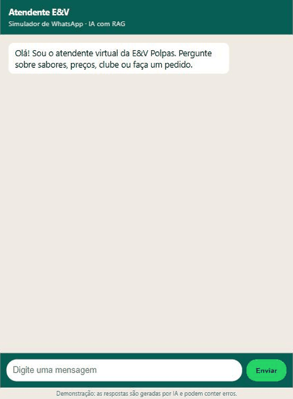

# Atendente E&V

Atendente de WhatsApp com IA para a **E&V Polpas**, negócio real de revenda de polpas de fruta em Salvador. Responde dúvidas com **RAG** sobre os documentos do negócio e usa **tool calling** em SQL para preço, estoque e pedidos, a custo zero.

> Projeto pessoal de Hugo Rodrigo, feito para estudar IA conversacional aplicada a atendimento.

## Demonstração



Preço calculado pelo banco (R$ 54,00), regra do clube vinda dos documentos, pergunta sem base encaminhada a uma pessoa e tentativa de injeção de prompt sem efeito. Gravada no simulador local com o `openai/gpt-oss-20b`; a avaliação de 97% foi feita com o `openai/gpt-oss-120b`.

## O que ele faz

- Responde perguntas (clube, entrega, sabores, regras de pedido) citando o documento de onde veio a resposta.
- Calcula preço e registra pedido pelo **banco**, nunca pelo modelo.
- Quando não sabe, encaminha para a pessoa responsável e registra a pergunta no painel.
- Webhook compatível com o formato do WhatsApp Cloud API, simulador web e painel admin.
- **Avaliação automática** com 39 perguntas (preço, clube, entrega, estoque, pedido, sem base, fora de escopo, injeção de prompt, sabor inexistente, prazo de entrega). Os 97% foram medidos nas 35 primeiras; veja [docs/eval-results.md](docs/eval-results.md).

## Como rodar

Requer [uv](https://docs.astral.sh/uv/) e uma chave grátis do [Groq](https://console.groq.com).

```bash
git clone https://github.com/21RodrigoS/atendente-ev && cd atendente-ev
uv sync
cp .env.example .env   # preencha LLM_API_KEY e ADMIN_TOKEN
uv run uvicorn app.main:create_app --factory --reload
```

- Simulador: http://localhost:8000
- Painel: http://localhost:8000/admin (pede o `ADMIN_TOKEN`)
- Docs da API: http://localhost:8000/docs

Na primeira execução o modelo de embeddings (~220 MB) é baixado uma vez.

### Trocar de provedor

O cliente fala o formato OpenAI. Para usar o Gemini, só mude o `.env`:

```env
LLM_BASE_URL=https://generativelanguage.googleapis.com/v1beta/openai/
LLM_MODEL=<modelo gemini>
LLM_API_KEY=<sua chave>
```

## Testes e avaliação

```bash
uv run pytest                              # testes sem rede (provedor falso)
uv run python -m eval.run --min 0.85       # avaliação com o provedor do .env
```

Resultados da avaliação: veja [docs/eval-results.md](docs/eval-results.md).

## Arquitetura

Veja [docs/architecture.md](docs/architecture.md). Em resumo: FastAPI, agente com busca vetorial (numpy) em `knowledge/*.md`, ferramentas SQL (SQLAlchemy/SQLite) e provedor de LLM intercambiável.

## Limites e próximos passos

- O envio real de mensagens pelo WhatsApp Cloud API ainda não está integrado (exige aprovação da Meta); o webhook já aceita o formato.
- Os dados de demonstração (sabores, preços e clientes) são de exemplo e não há dados de clientes reais no repositório.
- O plano grátis do Groq limita tokens por minuto e por dia (200 mil/dia por modelo no momento da medição); uma rodada de avaliação usa uma parte relevante disso. Quando o limite estoura, o atendente responde com uma mensagem de instabilidade. A API também aplica limite por IP.

## Estrutura

```
app/        API, agente, RAG, ferramentas e provedores
knowledge/  documentos que alimentam o RAG
eval/       perguntas e execução da avaliação
web/        simulador de WhatsApp e painel
tests/      testes automatizados
docs/       design, plano e arquitetura
```

## Licença

MIT
