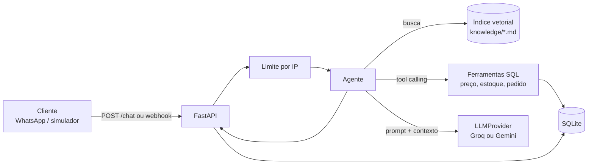

# Arquitetura

## Decisões

| Decisão | Por quê |
|---|---|
| Preço, estoque e pedido só por ferramentas SQL | Busca vetorial pode misturar ou desatualizar valores; o banco é a única fonte. |
| RAG só para texto (regras, entrega, clube, FAQ) | É o tipo de conteúdo em que a busca semântica ajuda. |
| Se não houver base, resposta fixa de encaminhamento | Evita que o modelo invente. A pergunta vai para o painel "Sem resposta". |
| Embeddings locais (`paraphrase-multilingual-MiniLM-L12-v2`) | Sem cota nem custo, funciona offline depois do primeiro download. |
| Índice em numpy, sem banco vetorial | São poucos trechos; cosseno em memória é simples e rápido. |
| Cliente HTTP único compatível com OpenAI | Groq e Gemini usam o mesmo formato; trocar é mudar `.env`. |
| Provedor e embedder falsos nos testes | Testes rápidos, determinísticos e sem rede. |

## Guardas

- Prompt de sistema proíbe alterar preço por pedido do cliente e ignora ordens para mudar as regras.
- Quantidade validada (0,5 a 20 kg) e clube exige 4 kg ou mais, tudo no código, não no prompt.
- Mensagem limitada a 1000 caracteres e 20 mensagens por minuto por IP.
- Falha ou limite do provedor devolve uma mensagem de instabilidade, nunca erro 500.
- Painel admin protegido por token. Sem `ADMIN_TOKEN` configurado, ele fica fechado.

## Próximos passos

- Integração real com o WhatsApp Cloud API (envio da resposta e aprovação da Meta).
- Confirmação de pedido com resumo antes de gravar e status do pedido.
- Avaliação contínua no CI com provedor real em horário agendado.
